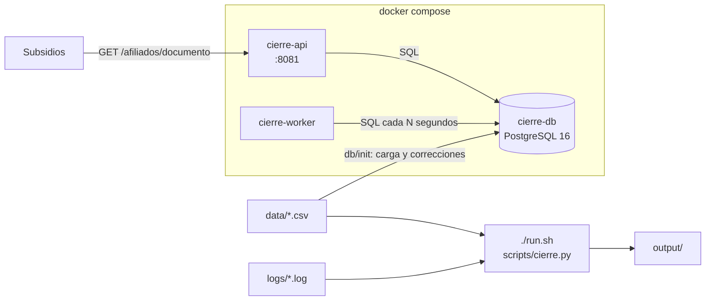

# Terminal Rescue — Daniel Díaz y Juan Camilo Martínez

Solución del reto **Terminal Rescue** (nivel Técnico) del FESC Legacy Challenge 2026.

## Descripción

Cada mes Operaciones de la Caja de Compensación ejecuta el cierre de afiliados: un proceso que genera el archivo de afiliados activos que usa Subsidios. Lo recibimos averiado: el worker no arrancaba, la API de consulta no conectaba a la base y luego respondía 500, el script de cierre no encontraba su entrada, destruía el archivo que leía y los totales no cuadraban con la hoja de control.

Este repositorio contiene el entorno reparado. Con `docker compose` levanta la base PostgreSQL, la API de consulta y el worker de conciliación. Con `./run.sh` ejecuta un cierre **repetible** que aplica las reglas de Operaciones y Auditoría (`docs/diccionario.md`): genera el archivo de activos, reporta cada problema de calidad de datos en un archivo de excepciones, cruza el extracto de Caja Oriente, calcula los totales que cuadran con la hoja de control e identifica el error más frecuente de los logs. Está pensado para el equipo de Operaciones y para Subsidios, que consume el archivo y la API.

## Integrantes

- Daniel Fernando Díaz Torres — Técnico Profesional en Ingeniería de Software, FESC
- Juan Camilo Martínez — Técnico Profesional en Ingeniería de Software, FESC

## Requisitos

- Docker Engine 24 o superior con el plugin Docker Compose v2 (`docker compose`).
- Bash, Git, `curl` y Python 3.8 o superior (solo biblioteca estándar) en la máquina que ejecuta `./run.sh` y `./validator`.
- Linux o macOS. En Windows: WSL 2 con Docker Desktop, o un GitHub Codespace (el repositorio trae `.devcontainer/` con Docker y Python listos).
- Puerto 8081 libre para la API.

## Instalación y ejecución

Desde una copia limpia del repositorio, en este orden:

```bash
git clone <url-del-repositorio> terminal-rescue
cd terminal-rescue
cp .env.example .env              # configuración local (no se versiona)
docker compose up -d --build      # levanta cierre-db, cierre-api y cierre-worker
docker compose ps                 # los tres servicios en estado running
./run.sh                          # ejecuta el cierre y genera output/
```

El entorno también levanta sin `.env`: cada variable tiene un valor por defecto en `docker-compose.yml`. La primera vez la base tarda unos segundos en cargar los CSV de `data/` y aplicar las correcciones de `db/init/`; `docker compose ps` la muestra `healthy` cuando está lista.

Para volver al estado inicial (borra contenedores, volúmenes y `output/`, y vuelve a levantar todo):

```bash
./reset.sh
./run.sh
```

## Configuración

Todas las variables están en `.env.example`. Se copian a `.env`, que está en `.gitignore` y nunca se sube al repositorio.

| Variable | Para qué sirve | Valor de ejemplo |
|---|---|---|
| `POSTGRES_DB` | Nombre de la base que crea el contenedor `cierre-db` | `cierre` |
| `POSTGRES_USER` | Usuario dueño de la base en `cierre-db` | `cierre` |
| `POSTGRES_PASSWORD` | Contraseña de ese usuario | un valor propio (en `.env.example` viene un marcador `cambiar-...`) |
| `DATABASE_HOST` | Host al que se conectan `cierre-api` y `cierre-worker`. Es el **nombre del servicio** en Compose, no `localhost` | `cierre-db` |
| `DATABASE_PORT` | Puerto de PostgreSQL dentro de la red de Compose | `5432` |
| `DATABASE_NAME` | Base a la que se conectan la API y el worker (igual a `POSTGRES_DB`) | `cierre` |
| `DATABASE_USER` | Usuario de conexión de la API y el worker (igual a `POSTGRES_USER`) | `cierre` |
| `DATABASE_PASSWORD` | Contraseña de conexión (igual a `POSTGRES_PASSWORD`) | la misma de `POSTGRES_PASSWORD` |
| `API_PORT` | Puerto de la máquina donde se publica `cierre-api` | `8081` |
| `WORKER_INTERVAL_SECONDS` | Segundos entre conciliaciones del worker: un número entero, sin unidad | `30` |

Variables opcionales de `./run.sh` (no hace falta definirlas): `CIERRE_ENTRADA` (carpeta de los CSV, por defecto `data`), `CIERRE_SALIDA` (por defecto `output`), `CIERRE_LOGS` (por defecto `logs`), `CIERRE_CONTROL` (por defecto `control/hoja_control.csv`) y `PYTHON` (intérprete a usar).

## Arquitectura

El sistema tiene tres servicios definidos en `docker-compose.yml`, que se comunican por la red interna de Docker Compose usando el nombre de cada servicio como host, y un proceso por lotes que se ejecuta en la máquina:

- **`cierre-db`** — PostgreSQL 16. Al crear el volumen ejecuta `db/init/`: `01_schema.sql` crea las tablas (todas de texto, como el sistema legacy, más `id_carga` con el orden de llegada), `02_load.sql` carga los CSV de `data/` y `03_correcciones.sql` corrige lo reparable (documentos repetidos y fechas en otros formatos), deja cada cambio en la tabla `correcciones` y expone lo irreparable en la vista `pendientes_calidad`. Su healthcheck usa TCP para quedar `healthy` solo cuando la carga terminó.
- **`cierre-api`** — API HTTP en Python (biblioteca estándar y `psycopg2`) publicada en el puerto 8081. Atiende `GET /afiliados/{documento}` y `GET /health` consultando `cierre-db`.
- **`cierre-worker`** — proceso en Python que cada `WORKER_INTERVAL_SECONDS` concilia el conteo de registros y documentos distintos de `afi_mae` y lo escribe en su log.
- **`./run.sh` → `scripts/cierre.sh` → `scripts/cierre.py`** — el cierre mensual. Lee los CSV de `data/` (fuente original, nunca se modifica), aplica las reglas del diccionario y escribe `output/`. `scripts/cierre.sh` calcula además el error más frecuente de `logs/` con `grep`, `sort` y `uniq`.



Decisiones principales: el cierre lee los CSV y no la base, para que corregir la base no cambie lo que se reporta y para que cada ejecución produzca exactamente la misma salida. Cada archivo de `output/` se escribe en un temporal y se renombra, así nunca queda a medias. Los servicios tienen `restart: unless-stopped` y manejan `SIGTERM`.

## Uso

**Consultar un afiliado:** `GET /afiliados/{documento}`

```bash
curl http://localhost:8081/afiliados/1098765432
```

```json
{"documento": "1098765432", "nombre": "JUAN CARLOS PEREZ GOMEZ", "estado": "ACTIVO", "empresa": "EMPRESA ABC"}
```

- Documento inexistente → `404` `{"error": "afiliado no encontrado"}`.
- Afiliado sin empresa válida → `200` con `"empresa": null`.
- Código de estado distinto de `A`/`I` → `200` con `"estado": "CODIGO_INVALIDO"`.
- Base caída → `503`. `GET /health` → `200 {"status": "UP"}`.

**Ejecutar el cierre:** `./run.sh` genera en `output/`:

| Archivo | Contenido |
|---|---|
| `output/afiliados_activos.csv` | `documento,nombre,estado,cod_empresa,empresa,beneficiarios,ultimo_aporte`: un registro por afiliado activo con empresa válida; `ultimo_aporte` es el mayor periodo pagado (`YYYY-MM`) |
| `output/excepciones.csv` | `documento,tipo,detalle` con `DUPLICADO`, `CODIGO_INVALIDO`, `SIN_EMPRESA`, `FECHA_INVALIDA`, `BENEFICIARIO_HUERFANO` y `CRUCE_NO_COINCIDE` |
| `output/totales.txt` | `total_afiliados`, `activos`, `inactivos` y `excepciones` en líneas `clave=valor` |
| `output/top_error.txt` | `codigo_error` y `ocurrencias` del error más frecuente en `logs/` |

Resultado con los datos del kit: `total_afiliados=1500`, `activos=1194`, `inactivos=274` (cuadran con `control/hoja_control.csv`), `excepciones=104` y `codigo_error=CIE-4012` con `ocurrencias=1424`. Al terminar, `./run.sh` compara los totales con la hoja de control y lo muestra en pantalla.

Otros scripts: `./scripts/corregir_base.sh` vuelve a aplicar las correcciones sobre una base existente (es idempotente) y `./scripts/evidencias.sh` regenera la carpeta `evidence/`.

## Pruebas

Con el entorno levantado:

```bash
./validator check                 # pruebas públicas del contrato: se espera PRUEBAS 10 / 10
./validator entregables           # revisa los documentos con las reglas del calificador
./run.sh > /dev/null && sha256sum output/* > /tmp/1.sha
./run.sh > /dev/null && sha256sum output/* > /tmp/2.sha
diff /tmp/1.sha /tmp/2.sha && echo "salidas idénticas"
curl -i http://localhost:8081/afiliados/0000000001   # se espera 404
```

Para probar la repetibilidad desde cero: `./reset.sh`, luego `./run.sh` y comparar de nuevo los `sha256sum`: deben ser idénticos a los de antes. Además, en cada `git push` GitHub Actions (`.github/workflows/validar.yml`) levanta el entorno desde una copia limpia en Linux, corre `./validator check`, prueba la repetibilidad tras `./reset.sh` y revisa los entregables; el resultado se ve en la pestaña Actions del repositorio. La salida real de todas estas pruebas está en `evidence/00-validator-check.txt` y `evidence/10-repetibilidad.txt`.

## Documentación

- [incident-report.md](incident-report.md) — los 10 incidentes: síntoma, diagnóstico, comandos, solución y evidencia.
- [evidence/](evidence/) — un archivo por incidente con la salida real de la terminal, antes y después del arreglo.
- [AI_USAGE.md](AI_USAGE.md) — cómo usamos inteligencia artificial y qué corregimos.
- [docs/diccionario.md](docs/diccionario.md) — diccionario de datos y reglas del cierre.
- [KIT.md](KIT.md), [RETO.md](RETO.md) y [RUBRICA.md](RUBRICA.md) — material de los organizadores.

## Qué resolvimos

Reparamos los diez incidentes. El worker caía porque `WORKER_INTERVAL_SECONDS` valía `30s`; la API buscaba un host `cierre-database` que no existe (el servicio se llama `cierre-db`); el script de cierre no tenía permiso de ejecución y leía de `/opt/cierre/entrada`. La consulta respondía 500 porque concatenaba nombres vacíos (`NULL`) y no toleraba códigos de estado inválidos ni afiliados sin empresa. Contamos el error más frecuente sumando los tres logs (CIE-4012, 1424 veces). Corregimos en la base los 20 documentos repetidos y 18 fechas, y reportamos lo irreparable en `excepciones.csv` (104 excepciones de seis tipos, incluidos 25 cruces con Caja Oriente). Los totales cuadran con la hoja de control y `./run.sh` produce salidas idénticas en cada ejecución, también después de `./reset.sh`. El detalle de cada incidente está en `incident-report.md`.

## Limitaciones y pendientes

- No sabemos qué valor espera Subsidios en `estado` para un código inválido ni en `empresa` para un afiliado sin empresa; respondemos `CODIGO_INVALIDO` y `null` y conviene acordarlo con ellos.
- Los códigos de estado inválidos, los afiliados sin empresa y los beneficiarios huérfanos no se pueden reparar sin información del sistema origen: quedan reportados para que Operaciones los corrija en la fuente.
- La API abre una conexión por consulta; con mucho tráfico convendría un pool de conexiones.
- Las credenciales de ejemplo son para desarrollo; en producción deben venir de un gestor de secretos.
